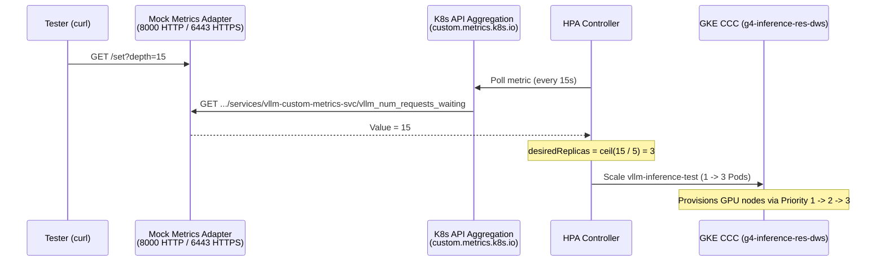

# Testing GKE Custom Compute Class (CCC) with HPA

A self-contained setup to test [**GKE Custom Compute Classes (CCC)**](https://cloud.google.com/kubernetes-engine/docs/concepts/about-custom-compute-classes) with the [**Horizontal Pod Autoscaler (HPA)**](https://cloud.google.com/kubernetes-engine/docs/concepts/horizontalpodautoscaler) using simulated LLM inference queue metrics.

---

## Problem Statement

Running GPU inference workloads on Kubernetes gets tricky when traffic spikes.

Most teams reserve a baseline of GPUs for steady everyday traffic. [Reservations](https://cloud.google.com/kubernetes-engine/docs/how-to/consume-reservations) keep costs predictable, but you don't want to pay for reserved GPUs that sit idle just to cover occasional bursts. When traffic spikes, standard on-demand GPUs are often out of stock in a single zone, so you need a fallback chain:

1. **[Reserved GPUs](https://cloud.google.com/kubernetes-engine/docs/how-to/consume-reservations) first** — use capacity you already paid for.
2. **[DWS Flex-Start](https://cloud.google.com/kubernetes-engine/docs/concepts/dynamic-workload-scheduler)** — if the reservation is full, queue briefly for capacity across zones.
3. **[Spot GPUs](https://cloud.google.com/kubernetes-engine/docs/concepts/spot-vms)** — grab spare Spot capacity across zones if you need nodes immediately.

Without [Custom Compute Classes](https://cloud.google.com/kubernetes-engine/docs/concepts/about-custom-compute-classes), building this fallback in GKE means managing multiple node pools and manually moving pods back to reserved nodes when capacity frees up.

Pod scaling has a similar catch: CPU and memory metrics don't reflect GPU load during [LLM inference](https://cloud.google.com/kubernetes-engine/docs/best-practices/machine-learning/inference). You have to scale on the inference request queue (like `vllm:num_requests_waiting`) using [custom metrics](https://cloud.google.com/kubernetes-engine/docs/how-to/custom-and-external-metrics). However, deploying vLLM, pulling large model weights, and setting up Prometheus + Cloud Monitoring just to test your HPA and CCC fallback rules takes a lot of time.

The two manifests in this folder let you test the entire flow in minutes using a lightweight mock metrics adapter and dummy GPU pods.

---

## How the Configs Work

### 1. `ccc-g4-res-dws.yaml` — Custom Compute Class

Defines a [`ComputeClass`](https://cloud.google.com/kubernetes-engine/docs/reference/crds/computeclass) named `g4-inference-res-dws`:

* **Auto-Creation & Active Migration**: Enables [Node Auto-Provisioning](https://cloud.google.com/kubernetes-engine/docs/how-to/node-auto-provisioning) (`nodePoolAutoCreation.enabled: true`) and [active migration](https://cloud.google.com/kubernetes-engine/docs/concepts/about-custom-compute-classes#active-migration) (`optimizeRulePriority: true`) so GKE automatically moves pods from fallback nodes back to reserved nodes when capacity opens up.
* **Node Consolidation (`autoscalingPolicy`)**: Waits 5 minutes (`consolidationDelayMinutes: 5`) before draining underutilized or empty GPU nodes (`gpuConsolidationThreshold: 100`).
* **Priority Fallback Chain (`priorities`)**:
  1. **Priority 1 (Reserved)**: `g4-standard-384` (8x `nvidia-rtx-pro-6000` GPUs) in `us-south1-a` consuming an automatic reservation (`affinity: AnyBestEffort`).
  2. **Priority 2 (DWS Flex-Start)**: Right-sized `g4-standard-96` (2x GPUs) across `us-south1-a`/`b` (`locationPolicy: ANY`, `flexStart.enabled: true`) so each 2-GPU burst pod gets its own node without waiting for an 8-GPU machine.
  3. **Priority 3 (Spot)**: `g4-standard-96` (2x GPUs) Spot VMs across `us-south1-a`/`b` if DWS cannot allocate within 180 seconds (`capacityCheckWaitTimeSeconds`).

### 2. `inference-queue-test.yaml` — Simulated Queue Adapter, Workload & HPA



* **Mock Metrics Adapter (`vllm-custom-metrics-adapter` + `APIService`)**:
  * Holds an in-memory variable (`queue_depth_per_pod = 2` on startup) and registers directly with the Kubernetes API aggregation layer (`v1beta1.custom.metrics.k8s.io`) over HTTPS (port `6443`). This lets HPA read updates immediately without waiting for an external monitoring pipeline.
  * Exposes `GET /set?depth=<N>` on HTTP port `8000` to change the simulated queue depth on the fly, plus `/metrics` for Prometheus scraping.
* **Simulated GPU Deployment (`vllm-inference-test`)**:
  * Starts with `1` replica requesting `2` GPUs (`nvidia.com/gpu: "2"`) and targets the ComputeClass via `nodeSelector: cloud.google.com/compute-class: g4-inference-res-dws`.
  * Runs a `python:3.11-slim` sleep container so pods become `Ready` as soon as the GPU node boots.
* **HPA (`vllm-queue-hpa`)**:
  * Queries `vllm_num_requests_waiting` on `Service/vllm-custom-metrics-svc` (`type: Object`) with `target.type: AverageValue` set to `"5"` (`minReplicas: 1`, `maxReplicas: 3`).
  * HPA divides the reported service metric across ready pods:
    $$\text{desiredReplicas} = \left\lceil \frac{\text{depth}}{5} \right\rceil$$

---

## Prerequisites

1. **GKE Cluster** (Standard with [Node Auto-Provisioning](https://cloud.google.com/kubernetes-engine/docs/how-to/node-auto-provisioning) enabled, or Autopilot) on GKE `1.31+`.
2. **[Least-privilege Node IAM Service Account](https://cloud.google.com/kubernetes-engine/docs/how-to/hardening-your-cluster#use_least_privilege_sa)** and sufficient **[GPU Quota](https://cloud.google.com/compute/resource-usage#gpu_quota)**.

---

## Getting Started

### 1. Configure & Apply the ComputeClass

In `ccc-g4-res-dws.yaml`, replace `<NODE_SERVICE_ACCOUNT>@<PROJECT_ID>.iam.gserviceaccount.com` with your node service account (and adjust `zones`, `machineType`, or `gpu.type` if testing with [different GPUs](https://cloud.google.com/kubernetes-engine/docs/concepts/gpus#gpus-list)):

```bash
kubectl apply -f ccc-g4-res-dws.yaml
```

### 2. Deploy the Test Suite & Verify Initial State

```bash
kubectl apply -f inference-queue-test.yaml
```

Wait for the custom metrics API and the initial GPU pod to become ready:

```bash
kubectl get apiservice v1beta1.custom.metrics.k8s.io
kubectl get hpa,pods -l test-suite=ccc-res-dws
```

Once the first pod is running, `vllm-queue-hpa` will show `TARGETS: 2/5` and `REPLICAS: 1` ($\lceil 2 / 5 \rceil = 1$).

### 3. Test Scale-Up (Traffic Spike)

Port-forward to the mock adapter and set the queue depth to `15`:

```bash
kubectl port-forward svc/vllm-custom-metrics-svc 8000:8000 &
curl "http://localhost:8000/set?depth=15"
```

Watch HPA and node provisioning in another terminal:

```bash
kubectl get hpa,pods,nodes -w
```

* Within 15–30 seconds, HPA calculates $\lceil 15 / 5 \rceil = 3$ and scales `vllm-inference-test` from `1` to `3` pods (`scaleUp.stabilizationWindowSeconds: 0`).
* If existing GPU nodes are full, the new pods go `Pending` and GKE provisions fallback nodes following Priority 1 $\rightarrow$ 2 $\rightarrow$ 3. Check which tier was used with:
  ```bash
  kubectl get nodes -L cloud.google.com/compute-class,cloud.google.com/gke-provisioning,cloud.google.com/gke-nodepool
  ```
* Once all 3 pods are `Ready`, the per-pod average settles at `5/5` (`15 / 3`) and holds steady.

### 4. Test Scale-Down & Node Consolidation

Drop the queue depth to `1`:

```bash
curl "http://localhost:8000/set?depth=1"
kill %1
```

* After 60 seconds (`scaleDown.stabilizationWindowSeconds`), HPA scales the deployment back to `1` replica ($\lceil 1 / 5 \rceil = 1$).
* After 5 minutes (`consolidationDelayMinutes`), GKE drains and removes the unneeded GPU nodes.

---

## Adapting for Real vLLM Workloads in Production

To use this setup with real **vLLM** pods instead of the mock adapter, use [Google Cloud Managed Service for Prometheus](https://cloud.google.com/stackdriver/docs/managed-prometheus) and the [Custom Metrics Stackdriver Adapter](https://cloud.google.com/kubernetes-engine/docs/how-to/custom-and-external-metrics):

1. **Install the Stackdriver Adapter** (after deleting the test `APIService`):
   ```bash
   kubectl apply -f https://raw.githubusercontent.com/GoogleCloudPlatform/k8s-stackdriver/master/custom-metrics-stackdriver-adapter/deploy/production/adapter_new_resource_model.yaml
   ```

2. **Scrape vLLM `/metrics` and scale on `Pods` metrics**:
   ```yaml
   apiVersion: monitoring.googleapis.com/v1
   kind: PodMonitoring
   metadata:
     name: vllm-pod-monitoring
   spec:
     selector:
       matchLabels:
         app: vllm-server
     endpoints:
       - port: http-metrics   # vLLM native /metrics port (8000)
         interval: 15s
         path: /metrics
   ---
   apiVersion: autoscaling/v2
   kind: HorizontalPodAutoscaler
   metadata:
     name: vllm-queue-hpa
   spec:
     scaleTargetRef:
       apiVersion: apps/v1
       kind: Deployment
       name: vllm-server      # Uses nodeSelector: cloud.google.com/compute-class: g4-inference-res-dws
     minReplicas: 1
     maxReplicas: 10
     metrics:
       - type: Pods
         pods:
           metric:
             name: prometheus.googleapis.com|vllm:num_requests_waiting|gauge
           target:
             type: AverageValue
             averageValue: "5"
   ```

---

## Cleanup

```bash
kubectl delete -f inference-queue-test.yaml
kubectl delete -f ccc-g4-res-dws.yaml
```

---

## Official Google Cloud Documentation

* [About Custom Compute Classes](https://cloud.google.com/kubernetes-engine/docs/concepts/about-custom-compute-classes) & [`ComputeClass` CRD Reference](https://cloud.google.com/kubernetes-engine/docs/reference/crds/computeclass)
* [Consume Compute Engine Reservations in GKE](https://cloud.google.com/kubernetes-engine/docs/how-to/consume-reservations)
* [Dynamic Workload Scheduler (DWS) in GKE](https://cloud.google.com/kubernetes-engine/docs/concepts/dynamic-workload-scheduler) & [Spot VMs in GKE](https://cloud.google.com/kubernetes-engine/docs/concepts/spot-vms)
* [Best Practices for Scaling LLM Inference on GKE](https://cloud.google.com/kubernetes-engine/docs/best-practices/machine-learning/inference)
* [Pod Autoscaling Based on Custom and External Metrics](https://cloud.google.com/kubernetes-engine/docs/how-to/custom-and-external-metrics)
